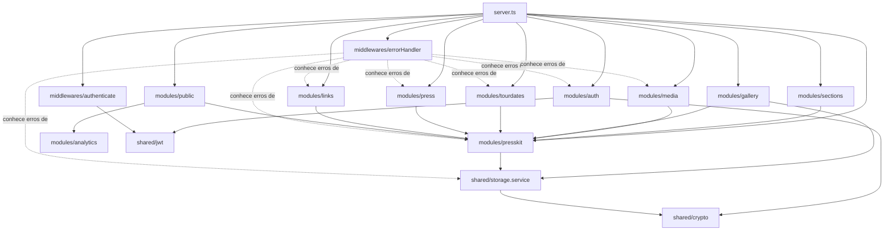
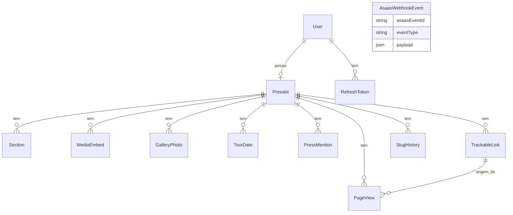

# Arquitetura — Presskit.AI

Monorepo (npm workspaces) com quatro pacotes:

- **`backend`** (`@presskit/api`) — Fastify + Prisma + PostgreSQL. API REST autenticada
  por JWT (access token curto + refresh token opaco rotativo).
- **`frontend`** (`@presskit/dashboard`) — React + Vite. Dashboard onde o artista edita
  o presskit (autenticado).
- **`ladingpage`** (`@presskit/site`) — Next.js. Marketing (`/`) e a página pública do
  presskit (`/[slug]`), renderizada no servidor para SEO/OG.
- **`packages/shared`** (`@presskit/shared`) — schemas Zod, constantes de domínio
  (planos, categorias, seções) e os componentes de renderização do presskit
  (`ui/PresskitRenderer` e blocos), consumidos tanto pelo dashboard (preview ao vivo)
  quanto pela landing page (página pública) — uma única fonte de verdade para como um
  presskit é desenhado.

## Camadas no backend

Cada domínio de negócio é uma pasta em `backend/src/modules/`, com no máximo dois
arquivos: `*.routes.ts` (handlers Fastify — validação de entrada com Zod, sem regra de
negócio) e `*.service.ts` (regra de negócio + acesso a dados via Prisma). Não há uma
camada de "repository" separada: o Prisma Client já é o data-access layer, e outra
camada por cima dele só adicionaria indireção sem ganho.

```
modules/
  auth/        cadastro, login, refresh/rotação de token, logout
  presskit/    CRUD do presskit, publish/unpublish, tema — o hub de posse (ver abaixo)
  sections/    conteúdo das seções singulares (bio, contato, tech rider, custom)
  media/       embeds de música/vídeo (Spotify/YouTube/SoundCloud/Vimeo)
  gallery/     upload e ordenação de fotos (presign R2 + confirmação)
  tourdates/   agenda de shows
  press/       clipping de imprensa
  links/       links rastreáveis (UTM-like, por código)
  analytics/   gravação de page views (ainda sem endpoint de leitura — ver observação)
  public/      endpoints públicos (sem auth): lookup de presskit por slug, registro de view
shared/        infraestrutura cross-cutting, não é um domínio de negócio:
  storage.service.ts   presign/HEAD/delete no R2 (usado por gallery/ e presskit/)
  jwt.ts                assinatura/verificação do access token (usado por auth/ e middlewares/)
  crypto.ts              hash/token opaco (usado por auth/ e shared/storage)
middlewares/    authenticate (decorator fastify.authenticate) e errorHandler (mapeia
                classes de erro de todo módulo para status HTTP)
config/         env.ts (schema Zod das variáveis de ambiente) e prisma.ts (client)
```

### `presskit.service.ts` é o hub de posse

Quase todo módulo filho (`sections`, `media`, `gallery`, `tourdates`, `press`,
`links`) chama `getOwnedPresskitOrThrow(userId)` de `modules/presskit/presskit.service.ts`
antes de agir — é o único lugar que resolve "este usuário é dono deste presskit?".
Isso é intencional, não acoplamento acidental: evita reimplementar a checagem de posse
em oito lugares diferentes, ao custo de todo módulo filho depender de `presskit/`.

`middlewares/errorHandler.ts` é o único arquivo que importa classes de erro de todos os
módulos — também intencional: é o único lugar que precisa saber "este tipo de erro
service vira este status HTTP", então centralizar ali é mais simples do que cada rota
tratar seu próprio erro.



> **Observação**: `modules/analytics/pageView.service.ts` hoje só grava (chamado por
> `public/public.routes.ts` a cada visita) — não existe ainda um endpoint de leitura
> nem uma tela de analytics no dashboard. Ele já vive em seu próprio módulo para ser o
> lugar natural onde esse endpoint de leitura entra depois, sem precisar mover nada.

## Modelo de dados



> Cobrança: `Subscription` (um por preapproval do Mercado Pago), `Payment` (uma por cobrança),
> `PaymentWebhookEvent` (dedup/auditoria dos webhooks) e `Feedback` — ver seção "Cobrança".

## Papéis e painel de administração

`User.role` é `USER` ou `SUPERADMIN`. Toda rota `/admin/*` passa por `authenticate` +
`requireSuperadmin` (o papel é relido do banco a cada request, nunca do JWT). O primeiro
operador nasce pela env `SUPERADMIN_EMAILS` (promovido no próximo login/cadastro); depois
disso a promoção é feita no próprio painel. Ninguém altera o próprio papel e o último
superadmin não pode ser rebaixado.

O painel (`frontend/src/pages/admin/`) cobre: visão geral (MRR, receita, assinaturas,
usuários ativos, visitas, feedback, séries de 30 dias), usuários (+ detalhe), assinaturas,
pagamentos (+ webhooks recebidos), inadimplência e feedback.

## Cobrança (Mercado Pago)

Modelo: **assinatura recorrente via Preapproval**, checkout hospedado pelo Mercado Pago
(`init_point`) — nenhum dado de cartão passa pela nossa stack. Preços vivem em
`packages/shared/src/constants/billing.ts` (`BILLING_PLANS`); o backend cobra sempre
`cycleTotalCents(cycle)`, o cliente só escolhe o ciclo.

Fluxo em `backend/src/modules/billing/`:

1. `POST /billing/checkout` cria a `Subscription` local (PENDING) e o preapproval no MP com
   `external_reference = subscription.id` e `back_url = PUBLIC_DASHBOARD_URL/assinatura?retorno=mp`.
   O painel redireciona para o `init_point`.
2. Ao voltar, o painel chama `POST /billing/sync`, que relê o preapproval — assim a confirmação
   não depende do webhook ter chegado.
3. `POST /webhooks/mercadopago` recebe `payment`, `subscription_preapproval` e
   `subscription_authorized_payment`. O corpo **nunca é confiado**: só o id é usado para
   re-consultar o recurso na API do MP. `x-signature` é validada quando
   `MERCADOPAGO_WEBHOOK_SECRET` existe. Cada evento vira uma linha em `PaymentWebhookEvent`
   (dedup + erro visível no painel); falha de processamento responde 500 para o MP retentar.
4. `runBillingHousekeeping` roda a cada hora (e via "Reconciliar" no painel): expira checkouts
   abandonados, ressincroniza assinaturas abertas e rebaixa quem teve o período pago encerrado.

Regras de estado (`billing.service.ts`):

- `User.planKey` é **derivado** por `syncEntitlement`: PRO enquanto houver assinatura AUTHORIZED
  sem atraso, ou CANCELLED/PAUSED ainda dentro do período pago. Usuário sem nenhuma
  `Subscription` não é tocado — é assim que um override manual do superadmin sobrevive.
- Inadimplência = assinatura AUTHORIZED com `failedCharges > 0` ou período pago vencido há
  mais de `BILLING_GRACE_DAYS` (3). Pagamento aprovado zera `failedCharges`, limpa `pastDue` e
  abre um novo período (`currentPeriodEnd = paidAt + meses do ciclo`).
- Cancelar mantém o PRO até `currentPeriodEnd`.

Configuração no MP: criar a aplicação, pegar o access token (teste → produção) e, em
"Suas integrações › Webhooks", apontar para `https://<api>/webhooks/mercadopago` com os três
tópicos acima; a chave secreta gerada vai em `MERCADOPAGO_WEBHOOK_SECRET`.

## Esqueci minha senha

`POST /auth/forgot-password` (3/min/IP) responde **202 sempre** — exista a conta ou não, tenha
o e-mail saído ou não — para não revelar quais e-mails estão cadastrados. Quando a conta
existe, gera um código de 6 dígitos (`crypto.randomInt`), guarda só o hash
(`sha256(userId:code)`) em `PasswordResetCode` com validade de 15 min, invalida códigos
anteriores e ignora novos pedidos por 60 s. `POST /auth/reset-password` compara o hash em
tempo constante, permite 5 tentativas por código, troca a senha e **revoga todos os refresh
tokens** do usuário. Envio via `shared/mailer.ts`: Resend (`RESEND_API_KEY`) ou SMTP
(`SMTP_*`); sem nenhum dos dois, dev imprime no console e produção loga erro (o painel admin
avisa). Tela: `/esqueci-senha` no dashboard; a landing só linka para ela.

## Feedback

`POST /feedback` (usuário autenticado, 5/min) grava tipo, nota 1–5 opcional e mensagem;
`GET /feedback/mine` mostra o histórico com a resposta do admin (`adminNote`). O superadmin
triagem em `/admin/feedback` (status NOVO → EM_ANALISE → RESOLVIDO).

## Personalização da página pública

Tudo que o artista configura em "Personalizar" vive em colunas de `Presskit` e é renderizado por
`packages/shared/src/ui/PresskitRenderer.tsx` (Server Component na landing, preview no painel —
o mesmo componente, sem JS próprio):

- **Fundo**: imagem (`themeBackgroundImage*`) + ajustes `themeBackgroundOverlay/Blur/Position/
  Attachment/Repeat` + `themeBackgroundPreset` (gradientes/texturas em CSS, desenhados com as
  variáveis de cor do tema — `BACKGROUND_PRESETS` em `constants/theme.ts`). O "fixo" é feito com
  uma camada `sticky` de altura zero, não com `background-attachment: fixed` (iOS ignora e quebra
  dentro do preview escalado do painel).
- **Identidade**: `coverImage*` (banner/capa), `avatarImage*` (foto redonda), `logoImage*`
  (substitui o nome; o `<h1>` continua com o texto em `sr-only` para SEO), `heroVideoUrl`
  (YouTube/Vimeo mudo em loop via `heroVideoEmbedSrc`). Uploads: `POST /presskit/images/:slot/
  upload-url` → PUT direto no bucket → `.../confirm`; `DELETE /presskit/images/:slot`.
- **Conversão**: `whatsappNumber/Message` (botão flutuante + CTA no topo, `wa.me`), `quickLinks`
  (até 8, ícones oficiais via `simple-icons`). Cliques em qualquer `[data-track]` são enviados por
  `ClickTracker` (landing) para `POST /public/presskits/:slug/click` → `LinkClick`, e aparecem
  em "Quem abriu".
- **Idiomas**: `languages` (`["pt"]` ou `["pt","en"]`); inglês em `Section.titleEn/dataEn`
  (`PATCH /presskit/sections/:type/translation`), mesclado campo a campo sobre o português no
  render. A landing lê `?lang=en` e expõe `alternates.languages`.
- **Cor da capa**: `frontend/src/lib/colorFromImage.ts` sugere paleta no navegador (canvas) a
  partir da capa/fundo — o `/media` responde com `Access-Control-Allow-Origin: *` justamente para
  o canvas poder ler a imagem.

### Domínio próprio do artista

Artista informa o domínio (`PUT /presskit/domain`, status `PENDING`) e recebe o CNAME
(`CUSTOM_DOMAIN_CNAME_TARGET`). O superadmin ativa em `/admin/dominios`
(`POST /admin/domains/:id/activate`): com `RAILWAY_API_TOKEN` + `RAILWAY_LANDING_SERVICE_ID` o
backend registra o domínio no serviço `landing` via GraphQL do Railway; sem token, o registro é
manual. A landing (`proxy.ts`) consulta `GET /public/domains/:host` (cache 5 min) para hosts que
não são nossos e reescreve `/` para `/<slug>` mantendo o domínio do artista na barra.
**Limite do plano Hobby: 2 domínios personalizados por serviço** — a landing já usa os dois
(`presskitai.com.br` + `www`); domínios de artistas exigem o plano Pro (20 por serviço).

### Site do artista: abas, seções e estilo por seção

A página pública é um site de uma página só, com navegação por âncoras. `Presskit.navMode`
escolhe entre `SCROLL` (menu fixo que rola até a seção) e `TABS` (uma seção por vez, feito só
com CSS `:target` — sem JS no cliente, funciona no SSR e em links diretos `#musica`);
`showNav` liga o menu e `tagline` é a frase abaixo do nome. As âncoras vêm de
`SECTION_ANCHORS` (shared) e o CSS das abas de `tabsCss()` no `PresskitRenderer`.

Cada `Section` tem `style` (JSON validado por `sectionStyleSchema`: cor de fundo, imagem
`backgroundImageUrl/Key`, preset de gradiente/textura, overlay, cores de texto/destaque, largura,
espaçamento, alinhamento, divisória) e `layout` (variantes por tipo em `SECTION_LAYOUTS`, ex.
galeria grade/mosaico/faixa, bio texto/dividida). `SectionShell` aplica tudo via CSS vars
(`sectionOverrides`), por cima dos defaults do template (`templates.ts`). O storage key da
imagem de fundo da seção é removido do payload público em `loadFullPublicPresskit`.

Tipos novos: `STATS`, `TESTIMONIALS`, `FAQ`, `DOWNLOADS` (dados em `Section.data`, sem
tabelas próprias). Seções são adicionadas/removidas com `POST|DELETE /presskit/sections/:type`;
remover apaga a imagem de fundo mas preserva coleções (fotos, mídias, datas), que voltam se a
seção for recriada. Arquivos para download e PDF do rider sobem por `/presskit/files/*`
(pasta `files`, pdf/zip/docx/pptx/mp3 até 50 MB) e são servidos por `/media/*` com
`Content-Disposition: attachment` para os formatos que o navegador abriria inline.

## Contas de produtora (AGENCY) e várias páginas por login

`User.accountType` é ARTIST ou AGENCY, decidido no onboarding (`POST /presskit/onboarding`,
campo `accountType`). Um usuário pode ter vários `Presskit` (o `@unique` de `userId` caiu):
a página primária (`agencyId = null`; para AGENCY tem `kind = AGENCY` e categoria
`PRODUTORA`) e, para produtoras, as páginas de artistas do casting (`agencyId` aponta para a
página da produtora, `displayName` guarda o nome artístico). Tudo pertence ao mesmo `userId`:
um login edita todas as páginas.

Qual página uma rota autenticada edita vem do header `X-Presskit-Id` (dashboard: store
`presskit-active`, interceptor do axios). `authenticate.ts` só copia o header para
`request.presskitId`; `getOwnedPresskitOrThrow(request)` resolve para a página pedida **se**
for do usuário, senão a primária — nunca confia no header. `GET /presskit/all` lista as páginas e
o uso de vagas; `POST /presskit/roster` cria artista (limite = `effectiveArtistSeats`);
`DELETE /presskit/roster/:id` apaga só páginas com `agencyId` (e seus uploads).

Vagas: `Subscription.seats` (planos de produtora são por artista/mês, `AGENCY_PRICING`,
packs `AGENCY_SEAT_OPTIONS`); `syncEntitlement` copia o maior pack ativo para
`User.artistSeats`; no teste grátis a produtora tem `AGENCY_TRIAL_SEATS` (3). A página pública
da produtora tem a seção `ROSTER` (artistas publicados, montada pelo backend em
`loadFullPublicPresskit`); a página do artista mostra "Artista de <produtora>" com link.

## Imagens enviadas

Toda imagem é redimensionada no navegador antes do PUT (`frontend/src/lib/imageResize.ts`,
`prepareImage(file, kind)`): avatar 800×800 e capa 1600×900 com corte central; logo contida em
1200×400 com transparência; fundo da página/seção e galeria contidas em 1920/2000 px; saída
WebP (PNG/JPEG onde o navegador não codifica WebP). O backend continua aceitando só
jpg/png/webp até 10 MB — o limite vira redundante, não a regra.

## Links de mídia (YouTube, Vimeo, Spotify, SoundCloud)

`packages/shared/src/media/parseMediaUrl.ts` é a única fonte de verdade para "esse link é
embedável, de qual provedor, e qual `src` vai no iframe". É usado em três lugares com o mesmo
resultado: o backend (`mediaEmbedCreateSchema`) rejeita links que não viram player; o editor
(`EmbedManager`) detecta o provedor a partir do link colado (sem dropdown); e o renderizador
público (`MediaEmbedBlock`) monta o iframe a partir do `embedSrc` — nunca da URL crua. YouTube
é embedado via `youtube-nocookie.com`.

## Segurança — decisões que não são óbvias no código

- **Toda URL que chega do cliente passa por `httpUrlSchema`** (`packages/shared/src/schemas/url.ts`),
  não por `z.string().url()` — este último aceita `javascript:` e `data:`, que viram XSS em
  qualquer `href`. Links de mídia são a exceção controlada: passam por `parseMediaUrl`.
- **Chaves de storage (R2) são sempre verificadas contra o prefixo do próprio presskit**
  (`assertOwnedStorageKey`) antes de confirmar ou apagar. Sem isso, confirmar a chave de outro
  artista e depois apagar a linha faria a API deletar o objeto dele. A URL pública é derivada no
  servidor (`publicUrlFor`), nunca aceita do cliente. Por isso `themeBackgroundImageUrl/Key`
  não existem em `presskitUpdateSchema` — só mudam via as rotas de upload.
- **Refresh token**: rotação a cada uso; apresentar um token já revogado é tratado como roubo
  e revoga todas as sessões do usuário. Login sempre executa um `bcrypt.compare` (contra um
  hash fictício se o e-mail não existe) para não vazar quais e-mails têm conta via timing.
- **Rate limit**: bucket global generoso (600/min/IP) porque a página pública é renderizada
  pelo serviço `landing`, logo todo o tráfego de visitantes chega à API de um único IP. Rotas de
  credencial (`/auth/login`, `/auth/signup`) têm bucket próprio de 10/min. `trustProxy: true`
  é obrigatório no Railway para que `request.ip` seja o cliente, não o proxy.
- **Headers de segurança/CSP**: landing em `next.config.ts` (`headers()`), dashboard em
  `frontend/public/serve.json` (lido pelo `serve` em produção), API via `@fastify/helmet`.
  A CSP da landing ainda usa `'unsafe-inline'` em scripts (Next injeta bootstrap inline); migrar
  para nonce via `proxy.ts` é o próximo passo.
- **Tokens no `localStorage`** (dashboard e landing) é a troca consciente atual: três origens
  diferentes tornam cookies `httpOnly` cross-site + CSRF um projeto à parte. O access token dura
  15 min e a CSP reduz a superfície de XSS enquanto isso.

## Deploy (Railway)

Projeto `presskit`, quatro serviços a partir do mesmo repositório (root = raiz do monorepo):

| Serviço   | Build                                        | Start                                        | Health   |
|-----------|----------------------------------------------|----------------------------------------------|----------|
| backend   | `npm run build --workspace=@presskit/api`    | `npm run start --workspace=@presskit/api`    | `/health`|
| frontend  | `npm run build --workspace=@presskit/dashboard` | `npm run start --workspace=@presskit/dashboard` (`serve -s dist`) | `/` |
| landing   | `npm run build --workspace=@presskit/site`   | `npm run start --workspace=@presskit/site`   | `/`      |
| Postgres  | template oficial                             | —                                            | —        |

- `backend` roda `npm run prisma:deploy --workspace=@presskit/api` como **pre-deploy command**
  (uma vez por deploy, antes do start — não a cada restart de réplica).
- Watch paths por serviço (`backend/**`, `frontend/**`, `ladingpage/**`, cada um + `packages/**`
  e os `package*.json` da raiz), para um push só redeployar o que mudou.
- `railway.json` (config-as-code) está **deprecado** no Railway — a configuração vive nas
  settings de cada serviço (aplicadas via API/dashboard).
- **Imagens (galeria e fundo)**: bucket S3 do Railway `presskit-media` (região sjc, criado com
  `railway bucket create`). As variáveis `STORAGE_ENDPOINT` / `R2_*` do backend vêm de
  `railway bucket credentials` — o nome `R2_*` é histórico, vale para qualquer S3. Upload é
  direto do navegador com URL pré-assinada (o bucket tem CORS para `app.presskitai.com.br`,
  o domínio provisório e `localhost:5173`). **Buckets do Railway são privados** (GET anônimo
  → 403), então a leitura pública é a rota `GET /media/<chave>` do backend
  ([storage.routes.ts](backend/src/modules/storage/storage.routes.ts)), que faz stream do
  objeto com `Cache-Control: immutable`; `R2_PUBLIC_BASE_URL=https://api.presskitai.com.br/media`
  é o prefixo gravado nas URLs. Só chaves `presskits/<id>/(gallery|theme-bg)/…` são servidas.
- **Domínios**: `presskitai.com.br` + `www` → landing (página pública em `/<slug>`),
  `app.presskitai.com.br` → painel, `api.presskitai.com.br` → backend. O plano Hobby permite 2
  domínios personalizados por serviço.
- **E-mail**: o Railway bloqueia SMTP de saída, então entrega real só por API HTTPS
  (`RESEND_API_KEY`). Enquanto o Resend não está configurado, o serviço `mailpit`
  (template oficial, volume em `/data`) recebe tudo pela rede privada
  (`SMTP_HOST=${{mailpit.SMTP_HOST}}`, porta 1025, usuário `smtp`, senha em
  `MP_SMTP_PASSWORD`) e mostra na UI em `mailpit-production-*.up.railway.app` (login na
  variável `MP_UI_AUTH` do serviço). O mailer dá prioridade ao Resend: basta adicionar a
  chave no backend que o Mailpit deixa de receber — nada mais precisa mudar.

Variáveis por serviço (além das injetadas pelo Railway):

- **backend**: `NODE_ENV=production`, `DATABASE_URL=${{Postgres.DATABASE_URL}}`,
  `JWT_ACCESS_SECRET`, `CORS_ORIGINS` (frontend + landing, separados por vírgula),
  `SUPERADMIN_EMAILS`, `PUBLIC_DASHBOARD_URL` (frontend). Cobrança: `MERCADOPAGO_ACCESS_TOKEN`,
  `MERCADOPAGO_WEBHOOK_SECRET`. Upload de imagens: `R2_ACCOUNT_ID`, `R2_ACCESS_KEY_ID`,
  `R2_SECRET_ACCESS_KEY`, `R2_BUCKET`, `R2_PUBLIC_BASE_URL`.
- **frontend**: `VITE_API_URL` (backend), `VITE_SITE_URL` (landing) — inlined no build.
- **landing**: `NEXT_PUBLIC_API_URL` (backend), `NEXT_PUBLIC_DASHBOARD_URL` (frontend) — inlined no
  build; opcionalmente `API_URL` para o SSR falar com o backend pela rede privada.

Ao trocar para domínios próprios, atualizar essas variáveis (e `CORS_ORIGINS`) e redeployar
frontend e landing, já que as `VITE_*`/`NEXT_PUBLIC_*` são resolvidas em build.

## Frontend do dashboard

`frontend/src/components/layout/DashboardLayout.tsx` é o layout de toda a área
logada (sidebar + `<Outlet/>`). O editor do presskit (Bio, Contato, Galeria, Tour
Dates, Links, Tema) continua em `pages/DashboardHomePage.tsx`, agora como uma rota
filha do layout. Novas áreas do produto (módulo "Projeto": Crie com IA / Uploads /
Modelos prontos) entram como outras rotas filhas do mesmo layout, em
`pages/projeto/`.
